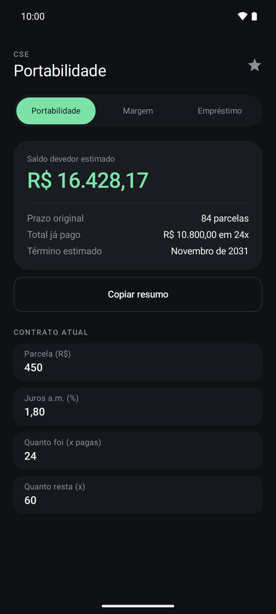
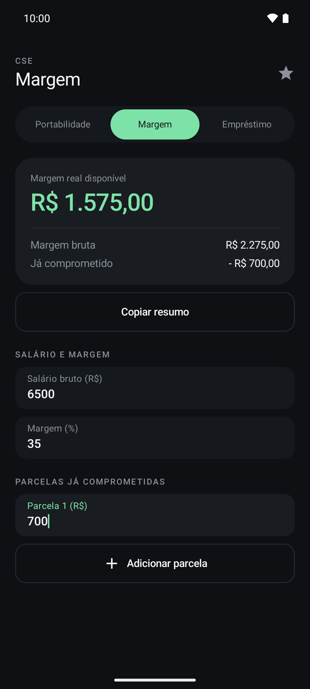
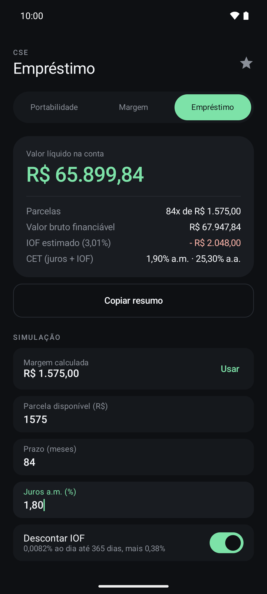

# CSE — Calculadora Simples de Empréstimo

App Android nativo (Kotlin + Jetpack Compose) para simular portabilidade de empréstimo consignado, calcular margem consignável disponível e simular a tomada de um novo empréstimo.

**[Baixar na Google Play](https://play.google.com/store/apps/details?id=com.cse.calculadora)**

| Portabilidade | Margem | Empréstimo |
|---|---|---|
|  |  |  |

## Funcionalidades

**Portabilidade** — estima o saldo devedor de um contrato existente a valor presente, pra avaliar se vale a pena portar o empréstimo.

**Margem** — calcula a margem consignável bruta a partir do salário e do percentual de margem, descontando as parcelas já comprometidas (é possível adicionar quantas parcelas forem necessárias). O resultado é sugerido automaticamente na aba de Empréstimo.

**Empréstimo** — simula o valor financiável de uma nova parcela ao longo do prazo, com opção de visualizar o valor bruto ou já descontando o IOF.

O IOF segue o Decreto 6.306/2007 para mutuário pessoa física: alíquota diária de 0,0082% sobre o principal de cada parcela (art. 7º, I, "b", 2 — redação do Decreto 8.392/2015), limitada a 365 dias por parcela (§ 1º), mais o adicional de 0,38% que independe do prazo (§ 15 — redação do Decreto 12.466/2025). A alíquota efetiva sai do prazo: fica perto de 1,9% em 12 meses e de 3,05% em 108. O app mostra o percentual calculado, não um valor fixo.

Com o IOF ligado, o cartão também mostra o **CET** — a taxa que iguala o que cai na conta ao fluxo de parcelas, na definição da Resolução CMN 4.881/2020 (art. 4º). É um CET parcial, de juros e IOF: tarifa, seguro prestamista e registro de contrato o app não tem como conhecer. Serve como piso — o CET informado pelo banco vem igual ou maior, e um CET declarado abaixo dele é sinal de proposta que não fecha.

Todos os cálculos de valor presente usam a fórmula da Tabela Price:

```
VP = PMT × [1 - (1 + i)^-n] / i
```

## Stack

- Kotlin
- Jetpack Compose (Material 3)
- MVVM com `ViewModel` + `StateFlow`
- JUnit
- Gradle (Kotlin DSL)

## Arquitetura

O app segue MVVM em três camadas bem separadas:

- **Cálculo** — `CalculadoraUtils` é um objeto puro, sem dependência de Compose nem do
  framework Android. É o que torna as fórmulas testáveis na JVM.
- **Estado** — `CseViewModel` é o dono do estado das três abas e expõe cada uma como um
  `StateFlow`. Por viver no escopo da Activity, o que foi digitado sobrevive à troca de aba
  e à rotação da tela. É também o que permite a aba Empréstimo ler a margem calculada na
  aba Margem sem que uma tela precise avisar a outra.
- **UI** — as composables recebem o estado pronto e emitem eventos. Não calculam nada.

## Estrutura

- `MainActivity.kt` — UI Compose: navegação por abas e os três formulários/resumos.
- `calculadoraportabilidade.kt` — lógica de cálculo pura (`CalculadoraUtils`).
- `ui/CseViewModel.kt` — estado das três abas e os eventos vindos da tela.
- `ui/CseUiState.kt` — os campos digitados e os valores derivados de cada aba.
- `ui/theme/` — paleta de cores e tipografia Material 3.

## Testes

```bash
./gradlew test
```

48 testes de JVM cobrindo a fórmula da Tabela Price, o parsing de moeda em pt-BR, a
sanitização da digitação (inclusive o ponto digitado como separador decimal), o limite
de dígitos dos campos de meses e o comportamento das abas (margem estourada, sugestão de
parcela, o IOF do decreto (teto de 365 dias e adicional) e estado preservado entre abas).

## Build

```bash
./gradlew assembleDebug
```

O build de release usa R8 (`isMinifyEnabled = true`) e `shrinkResources` para reduzir o tamanho final do APK/AAB.

## Licença

© 2026 Iordan Santos Silva Filho. Todos os direitos reservados.
O código está público para leitura e estudo; ele não pode ser copiado nem republicado como outro app.
